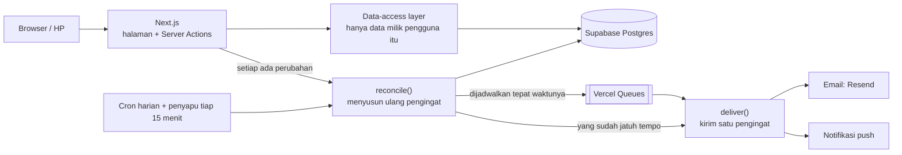

# Montenku

**Monitor kontenku**: penjadwal dan pengingat konten untuk kreator yang mengelola beberapa akun TikTok, Instagram, dan YouTube sekaligus, masing-masing dengan jadwal dan zona waktunya sendiri.

## Cara kerja

### Dari sisi pengguna

1. **Daftar dan masuk** dengan email dan kata sandi.
2. **Tambah akun konten** di halaman Akun konten: nama, platform, handle, warna, dan zona waktu. Setiap akun tampil dengan warnanya sendiri di kalender.
3. **Buat jadwal berulang** di halaman Jadwal berulang, misalnya "upload tiap Selasa dan Jumat 19:00" untuk satu akun. Montenku menyimpannya sebagai satu aturan, lalu menghitung setiap kemunculannya saat dibutuhkan. Satu kemunculan bisa dilewati atau digeser tanpa mengubah aturannya.
4. **Isi kontennya.** Setiap kemunculan yang belum terisi tampil sebagai *slot kosong*. Tombol "Isi konten" mengubahnya menjadi konten dengan judul, status (Ide → Naskah → Produksi → Editing → Siap → Terposting), tenggat per tahap, tag, dan catatan markdown. Konten juga bisa dibuat langsung tanpa jadwal.
5. **Pantau di kalender dan dashboard.**
   - Kalender Bulan, Minggu, dan Daftar, untuk semua akun sekaligus atau per akun. Setiap posting tampil di jam zona waktu akunnya.
   - Dashboard Hari ini dan Minggu ini: apa yang harus diproduksi dan diposting, tenggat yang mendekat, yang terlambat, dan peringatan **bentrok** kalau dua posting satu akun dijadwalkan di menit yang sama.
6. **Pasang pengingat** di konten atau jadwal (tepat waktu, 1 jam sebelum, H-1, dan seterusnya). Pengingat dikirim lewat **email** dan **notifikasi push** di perangkat yang mengaktifkannya. Setiap pengingat menampilkan statusnya (Terjadwal, Terkirim, Gagal), dan yang gagal bisa dikirim ulang.
7. **Atur sesuai kebutuhan** di Pengaturan: email nyala atau mati, jam senyap (pengingat ditunda sampai jam senyap selesai), zona waktu pengguna, notifikasi push per perangkat, dan hapus akun beserta semua datanya.
8. **Lihat jadwal di aplikasi kalender lain.** Setiap akun konten bisa punya tautan `.ics` rahasia untuk berlangganan dari Google Calendar atau Apple Calendar.

### Di balik layar



- **Data setiap pengguna terpisah.** Setiap query ke database selalu disaring dengan ID pengguna yang sedang masuk. Membuka konten orang lain lewat URL hanya menghasilkan "tidak ditemukan".
- **Pengingat disimpan dulu di tabel `reminders`**, satu baris per pengingat per kanal (email atau push). Setiap kali konten, jadwal, atau pengaturan berubah, `reconcile()` menyusun ulang baris-baris itu untuk 48 jam ke depan: membuat yang baru, menggeser yang waktunya berubah, dan membatalkan yang tidak berlaku lagi.
- **Antrean mengirim tepat pada waktunya.** Setiap pengingat dimasukkan ke Vercel Queues dengan jeda sampai waktu kirimnya. Saat pesan tiba, `deliver()` membaca ulang barisnya dan "mengklaim"-nya secara atomik. Pesan yang datang dua kali, atau pengingat yang sudah dibatalkan, tidak dikirim lagi, jadi setiap pengingat terkirim **tepat satu kali**.
- **Jaring pengaman.** Cron harian dan penyapu tiap 15 menit menjalankan `reconcile()` yang sama, sehingga pengingat yang tertinggal (misalnya karena server sempat mati) tetap terkirim. Pengiriman yang gagal diulang sampai 5 kali, lalu ditandai Gagal.
- **Waktu selalu dihitung di zona yang benar.** Jadwal berulang disimpan dalam jam dinding zona akunnya (misalnya 19:00 WIB), lalu dikonversi ke waktu dunia saat dibutuhkan, termasuk untuk zona yang memakai jam musim panas.

Alasan di balik setiap keputusan teknis dicatat di [DECISIONS.md](DECISIONS.md).

## Menjalankan di laptop

Butuh **Node 24** dan project Supabase (paket Free cukup).

1. Pasang dependensi:
   ```bash
   npm install
   ```
2. Salin `.env.example` menjadi `.env`, lalu isi. Minimal `DATABASE_URL`, `DIRECT_URL`, `BETTER_AUTH_SECRET`, dan `BETTER_AUTH_URL`. Upstash (rate limit), Resend (email), kunci VAPID (push), dan `CRON_SECRET` boleh kosong di laptop: fiturnya mati, dan pengingat yang tidak bisa dikirim tercatat Gagal dengan pesan yang jelas.
3. Jalankan migrasi ke database:
   ```bash
   npm run db:migrate
   ```
4. Nyalakan app, lalu buka http://localhost:3000:
   ```bash
   npm run dev
   ```

Di laptop, antrean Vercel tidak tersedia. Pengingat dikirim saat route cron dipanggil: `GET /api/cron/reconcile` dengan header `Authorization: Bearer <CRON_SECRET>`.

### Menjalankan test

```bash
npm test            # test unit dan database, memakai Postgres sementara yang dibuat dan dihapus otomatis
npm run test:e2e    # build, lalu test di browser (Playwright, Chromium)
npm run typecheck
npm run lint
```

Test tidak pernah menyentuh Supabase, Resend, Upstash, atau layanan push.
