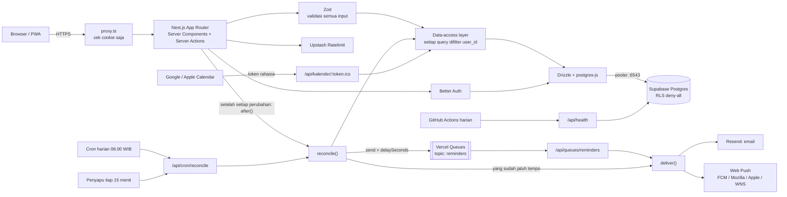
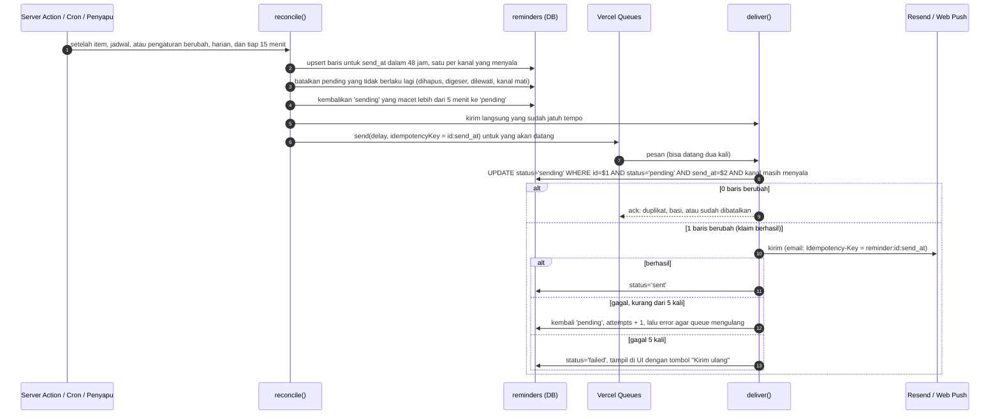

# Montenku

**Monitor kontenku**: penjadwal dan pengingat konten untuk kreator yang mengelola beberapa akun TikTok, Instagram, dan YouTube sekaligus, masing-masing dengan jadwal dan zona waktunya sendiri.

Demo live: *diisi setelah deploy (Fase 7 Langkah 3).*

Proyek ini fokus pada tiga hal yang sering salah di aplikasi penjadwal: **logika waktu** (zona waktu, DST, jadwal berulang), **pengingat yang tepat waktu dan tidak pernah terkirim ganda**, dan **isolasi data antar pengguna**. Setiap keputusan penting dan alasannya dicatat di [DECISIONS.md](DECISIONS.md) (D-001 sampai D-038).

## Fitur

- **Akun konten**: nama, platform, handle, warna, dan zona waktu per akun. Bisa diarsipkan dan dipulihkan.
- **Konten**: judul, deskripsi, tag, status (Ide → Naskah → Produksi → Editing → Siap → Terposting), tenggat per tahap, dan banyak catatan markdown per konten.
- **Jadwal berulang**: misalnya "upload tiap Selasa dan Jumat 19:00". Disimpan sebagai satu aturan (RRULE), bukan ratusan baris. Satu kemunculan bisa dilewati atau digeser, dan slot kosong bisa langsung diisi konten.
- **Kalender** Bulan, Minggu, dan Daftar, gabungan atau per akun. Setiap posting tampil di jam zona akunnya.
- **Dashboard** Hari ini dan Minggu ini: yang harus diproduksi dan diposting, tenggat yang mendekat, yang terlambat, dan **bentrok** (dua posting satu akun di menit yang sama).
- **Pengingat** dengan offset (tepat waktu, 1 jam, 2 jam, H-1, dan seterusnya) lewat **email** (Resend) dan **notifikasi push** (Web Push, PWA). Masing-masing kanal punya status, dan yang gagal bisa dikirim ulang.
- **Pengaturan**: email nyala/mati, jam senyap, zona waktu pengguna, push per perangkat, dan hapus akun (ketik HAPUS plus kata sandi).
- **Langganan kalender**: tautan `.ics` rahasia per akun konten untuk Google Calendar atau Apple Calendar.

## Stack

Next.js 16 (App Router, Server Actions, TypeScript strict) · Supabase Postgres (hanya database) · Drizzle ORM + postgres-js · Better Auth · Vercel Queues · Resend · Web Push (`web-push`) · Upstash Redis (rate limit) · `rrule` + Temporal (`temporal-polyfill`) · Zod · Tailwind CSS + komponen gaya shadcn/ui · Vitest + embedded-postgres · Playwright · GitHub Actions · Vercel.

## Arsitektur



- **`proxy.ts` hanya mengecek ada tidaknya cookie** untuk redirect cepat. Sesi yang sebenarnya divalidasi di server oleh `requireUser()` di setiap halaman dan action (D-018).
- **Hanya DAL yang boleh mengimpor database.** Aturan ini dijaga ESLint (D-016).
- Mutasi dari UI memakai Server Actions. Endpoint yang dipanggil dari luar (queue, cron, health, feed .ics) memakai Route Handlers.

## Desain pengingat

Tabel `reminders` adalah **satu-satunya sumber kebenaran**. Pesan antrean hanya "mengetuk pintu": penerimanya selalu membaca ulang barisnya dulu.



Bagaimana "tepat satu kali" dijaga:
- **Dua kunci idempotency** (D-006). Database: unik `(reminder_setting_id, occurrence_key, channel)`, jadi tidak ada baris ganda. Antrean: `id:send_at`, jadi pengingat yang digeser menjadi pesan baru, sedangkan pesan ulangan dibuang.
- **Klaim atomik** `pending → sending` dengan `UPDATE ... WHERE status = 'pending'`: dari dua pekerja yang datang bersamaan, hanya satu yang mendapat barisnya. Ada test yang mengirim pesan yang sama dua kali dan memastikan email hanya terkirim sekali.
- **Status `sending` dengan lease 5 menit** (D-007): kalau pekerja mati setelah klaim, penyapu memulihkan dan mengirimnya. Kunci idempotency Resend (24 jam) mencegah email kedua kalau email pertama ternyata sudah terkirim.
- **Antrean tidak bisa dibatalkan.** Karena itu pembatalan dan penggeseran dilakukan di database, dan pesan lama otomatis menjadi no-op.
- **Jendela 48 jam** (D-005). Delay antrean ada batasnya, jadi baris hanya dibuat 48 jam sebelum waktu kirim. Cron harian yang gagal sekali masih aman, dan penyapu 15 menit menjadi jaring pengaman. Cron tidak pernah dipakai untuk menentukan waktu kirim.
- **Push** (D-036): satu baris push dikirim ke semua perangkat pengguna. Baris dianggap terkirim begitu satu perangkat menerima, sehingga pengulangan tidak pernah mengenai perangkat yang sudah menerima.
- **Jam senyap** menggeser `send_at` sebelum baris disimpan (D-032), jadi semua jaminan di atas tetap berlaku.

Semua alur ini diuji dengan **jam palsu** dan sender palsu: duplikat, crash setelah klaim, crash setelah kirim, gagal 5 kali, digeser, dihapus, DST, dan isolasi antar pengguna ([tests/reminders.test.ts](tests/reminders.test.ts), [tests/push-reminders.test.ts](tests/push-reminders.test.ts)).

## Jadwal berulang dan zona waktu

- **Kemunculan dihitung saat dibutuhkan**, tidak disimpan (D-002). Yang disimpan hanya aturan, pengecualian (lewati atau geser), dan konten yang mengisi slot.
- **`rrule` hanya berhitung kalender**, dengan tanggal "mengambang" tanpa TZID. Konversi ke zona waktu dilakukan Temporal (D-001, D-003), dan hanya [src/lib/time.ts](src/lib/time.ts) yang menyentuh zona waktu.
- **Kunci kemunculan = jam dinding** (`2026-11-27T19:00`, D-004), sehingga mengganti zona akun tidak merusak pengecualian atau slot yang sudah terisi.
- Test memakai zona ber-DST (`America/New_York`): jam yang tidak ada, jam yang muncul dua kali, dan akun yang pindah zona.

## Keamanan dan isolasi data

- **Isolasi dijaga DAL**: setiap fungsi menerima `userId` dari sesi, tidak pernah dari input. Milik orang lain menghasilkan "tidak ditemukan". Foreign key komposit `(id, user_id)` menjadi lapisan kedua di database (D-008).
- **RLS deny-all di semua tabel**, dengan test yang gagal kalau ada tabel baru yang lupa. App terhubung sebagai pemilik tabel, jadi RLS hanya menutup Data API Supabase.
- **Test isolasi** di setiap modul DAL, ditambah test E2E: pengguna kedua membuka URL milik pengguna pertama.
- **Rate limit** (Upstash) untuk masuk (20/15 menit per IP, 5/15 menit per email), daftar (5/jam per IP), simpan data (30/menit), dan hapus akun. Endpoint HTTP Better Auth yang tidak dipakai ditutup, jadi batas ini tidak bisa dilewati (D-020).
- **Web Push**: server hanya mau mengirim ke layanan push resmi browser, untuk mencegah SSRF (D-037).
- **Feed .ics**: token acak 256 bit per akun, bisa dibuat ulang atau dimatikan kapan saja (D-035).
- Secret hanya ada di environment variable. Contohnya di [.env.example](.env.example).

## Trade-off yang dipilih

| Pilihan | Alternatif | Kenapa | Harga yang dibayar |
| --- | --- | --- | --- |
| Kemunculan dihitung saat dibutuhkan | Simpan setiap kemunculan sebagai baris | Satu sumber kebenaran; mengubah aturan tidak perlu migrasi data | Setiap tampilan menghitung ulang; jendela dibatasi (kalender per bulan, dashboard 30 hari, feed 365 hari) |
| Satu `reconcile()` idempotent untuk cron, penyapu, dan setelah edit | Logika terpisah per pemicu | Satu jalur yang diuji; aman dijalankan dua kali bersamaan | Pengingat yang jauh baru masuk antrean saat masuk jendela 48 jam |
| Status `sending` + lease (menyimpang dari brief) | Langsung `pending → sent` | Crash setelah klaim tidak membuat pengingat hilang diam-diam | Satu status dan satu langkah pemulihan tambahan |
| Push dianggap terkirim begitu satu perangkat menerima | Ulangi untuk perangkat yang gagal | Brief mengutamakan "tidak pernah ganda" | Perangkat yang sedang bermasalah melewatkan pengingat itu |
| Isolasi di DAL, RLS deny-all | Policy RLS per pengguna | App memakai koneksi server, bukan JWT Supabase | Disiplin kode, dijaga lint dan test isolasi |
| Supabase cloud untuk dev, Postgres asli lokal (embedded-postgres) untuk test | Docker / Supabase CLI | Laptop pengembang terbatas | Test tidak menguji fitur khusus Supabase (hanya Postgres) |
| Resend dan antrean lewat adapter tipis | SDK langsung di kode bisnis | Mesin pengingat diuji dengan jam dan sender palsu | Sedikit kode penghubung |
| Feed .ics dan email ditulis sendiri (tanpa library) | `ical-generator`, SDK Resend | Formatnya kecil dan diuji per byte | Harus menjaga aturan RFC 5545 sendiri |

## Struktur folder

```
src/
  app/              halaman (nama rute Indonesia: /kalender, /jadwal, /konten, /pengaturan) dan route API
  server/dal/       data-access layer: satu-satunya yang menyentuh database
  server/actions/   Server Actions (validasi Zod, rate limit, panggil DAL)
  server/           pengirim email dan push, adapter antrean, rate limit
  lib/              logika murni: waktu, kemunculan, kalender, .ics, validasi
  db/schema/        skema Drizzle
drizzle/            migrasi SQL
tests/              Vitest: unit, DAL, isolasi, mesin pengingat (Postgres asli)
e2e/                Playwright: alur utama dan isolasi
public/             service worker dan ikon PWA
docs/               arsitektur Fase 0 dan catatan desain UI
```

## Menjalankan di laptop

Butuh **Node 24** dan project Supabase (paket Free cukup).

1. Pasang dependensi:
   ```bash
   npm install
   ```
2. Salin `.env.example` menjadi `.env`, lalu isi. Minimal `DATABASE_URL`, `DIRECT_URL`, `BETTER_AUTH_SECRET`, dan `BETTER_AUTH_URL`. Upstash, Resend, VAPID, dan `CRON_SECRET` boleh kosong di laptop: fiturnya mati dan pengingatnya tercatat gagal dengan pesan yang jelas.
3. Jalankan migrasi ke database:
   ```bash
   npm run db:migrate
   ```
4. Nyalakan app di http://localhost:3000:
   ```bash
   npm run dev
   ```

Di laptop, antrean Vercel tidak tersedia. Pengingat dikirim oleh route cron saat jatuh tempo: panggil `/api/cron/reconcile` dengan `Authorization: Bearer <CRON_SECRET>`.

## Test

```bash
npm test            # Vitest, memakai Postgres sementara yang dibuat dan dihapus otomatis
npm run test:e2e    # build lalu Playwright (Chromium): alur utama dan isolasi
npm run typecheck
npm run lint
```

Kedua jenis test tidak pernah menyentuh Supabase, Upstash, Resend, atau layanan push. [CI](.github/workflows/ci.yml) menjalankan semuanya di setiap push ke `main` dan setiap pull request.

## Deploy

Dideploy ke Vercel ([vercel.json](vercel.json): konsumen antrean, cron harian, dan penyapu 15 menit). Isi environment variable yang sama dengan `.env.example`. Di production, Upstash, Resend, VAPID, dan `CRON_SECRET` wajib, dan app menolak start tanpa mereka. Workflow [keep-alive](.github/workflows/keep-alive.yml) memanggil `/api/health` setiap hari setelah variabel repo `HEALTH_URL` diisi, supaya project Supabase Free tidak di-pause.

## Dokumen lain

- [DECISIONS.md](DECISIONS.md): setiap keputusan teknis (konteks, pilihan, alasan, test).
- [docs/fase-0-arsitektur.md](docs/fase-0-arsitektur.md): rancangan awal (ERD, alur pengingat, analisis risiko).
- [docs/desain-ui.md](docs/desain-ui.md): aturan desain UI.
