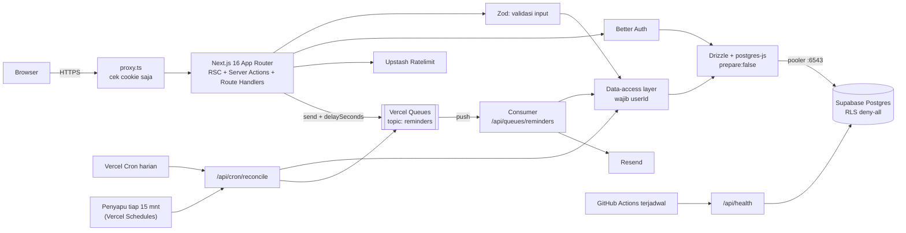
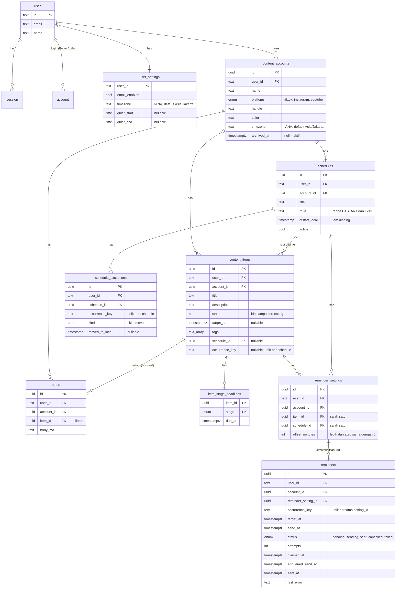
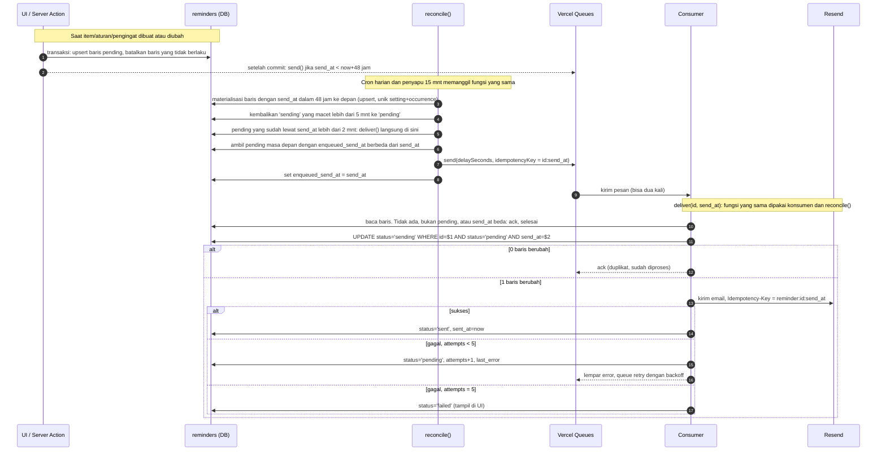

# PostingKu — Fase 0: Arsitektur

Status: **draf, menunggu persetujuan**. Belum ada kode. Keputusan teknis dan alasannya ada di [DECISIONS.md](../DECISIONS.md); dokumen ini menjelaskan bentuk sistemnya.

## 1. Gambaran besar

Aturan alur:
- **`proxy.ts` hanya mengecek keberadaan cookie** untuk redirect. Sesi yang sebenarnya divalidasi di server lewat `requireUser()` di DAL. Cookie ada belum berarti sesinya sah.
- **Semua akses data lewat DAL.** Kode di luar `src/server/dal/` tidak boleh mengimpor `db` (dijaga aturan lint di Fase 1).
- Mutasi dari UI memakai Server Actions. Endpoint yang dipanggil dari luar (queue, cron, health) memakai Route Handlers.

## 2. ERD

Prinsip:
- **`user_id` ditulis di setiap tabel milik pengguna** (denormalisasi sengaja). DAL cukup menambah `WHERE user_id = $1` tanpa join, jadi filternya sederhana dan sulit terlupa.
- **Foreign key komposit `(account_id, user_id)`** ke `content_accounts(id, user_id)`. Database sendiri menolak item milik pengguna A yang menempel ke akun konten pengguna B.
- Better Auth punya tabel bernama `account` (akun login). Supaya tidak tertukar, **akun konten = `content_accounts`**.
- Waktu absolut disimpan sebagai `timestamptz` (UTC). Waktu "jam dinding" aturan berulang disimpan sebagai `timestamp` tanpa zona, dipasangkan dengan zona waktu akun.

Catatan ERD:
- `occurrence_key` = jam dinding asli kemunculan, format `YYYY-MM-DDTHH:mm` (mis. `2026-12-01T19:00`). Kunci ini **tidak berubah** walau zona waktu akun diganti, jadi pengecualian dan item yang tertaut tetap menempel ke slot yang benar. Untuk item sekali-jadi, kuncinya konstan `once`.
- `reminder_settings` adalah definisi ("H-1 hari"). `reminders` adalah baris konkret per kemunculan yang benar-benar akan dikirim, dan hanya dibuat jika `send_at`-nya jatuh dalam 48 jam ke depan (lihat §4).
- `status` item: `ide → naskah → produksi → editing → siap → terposting`.
- Enum platform hanya berisi 3 sesuai brief. Menambah "lainnya" berarti fitur baru, jadi tanya dulu.
- Hapus akun memakai `ON DELETE CASCADE` dari `user`.
- RLS diaktifkan di **semua** tabel `public`, termasuk tabel Better Auth, tanpa policy.

## 3. Jadwal berulang: dihitung saat dibutuhkan

Aturan disimpan sebagai satu baris (`rrule` + `dtstart_local` + zona waktu akun). Kemunculan dihitung saat kalender, dashboard, atau pengisi pengingat butuh rentang tertentu.

Langkah menghitung kemunculan di rentang `[from, to)`:
1. Ubah `from`/`to` ke jam dinding zona akun, beri margin ±1 hari.
2. Jalankan `rrule` dengan `dtstart` "mengambang": komponen jam dinding dibungkus `Date.UTC(...)`, **tanpa TZID**. Dengan begitu `rrule` hanya berhitung kalender dan tidak menyentuh zona waktu, padahal bagian zona waktu itulah yang paling banyak bug-nya.
3. Setiap hasil → `Temporal.PlainDateTime` → `.toZonedDateTime(tz, { disambiguation: 'compatible' })` → instant UTC.
4. Terapkan pengecualian: `skip` dibuang, `move` diganti `moved_to_local`.
5. Slot yang sudah punya `content_items` tertaut (`schedule_id + occurrence_key`) ditampilkan sebagai item itu, di `target_at` milik item.
6. Saring hasil ke `[from, to)` berdasarkan instant.

DST (zona yang punya jam musim panas, mis. `America/New_York`):
- Jam yang tidak ada (02:30 saat jam maju) digeser `compatible` ke 03:30.
- Jam yang muncul dua kali (01:30 saat jam mundur): `compatible` memilih yang pertama.
- Asia/Jakarta tidak punya DST, jadi **test juga wajib memakai zona ber-DST**.

Kapan item dibuat dari slot: saat pengguna mulai mengerjakan slot itu (mengisi judul, mengubah status, atau menambah catatan). Sebelum itu, slot hanya "virtual".

## 4. Alur pengingat

Kenapa bentuknya begini (ringkas; detail di DECISIONS.md):
- **Pesan queue tidak bisa dibatalkan.** Tidak ada API hapus untuk pengirim. Karena itu pembatalan dan penjadwalan ulang dilakukan di DB, dan konsumen **selalu membaca ulang baris** sebelum bertindak. Pesan basi otomatis jadi no-op. Ini juga menangani akun yang sudah dihapus.
- **Ada dua kunci idempotency yang berbeda:**
  - DB: unik `(reminder_setting_id, occurrence_key)`, supaya tidak ada baris ganda.
  - Queue: `id:send_at`. Dedup queue berlaku selama retensi pesan. Saat pengingat digeser, `send_at` baru menghasilkan kunci baru, jadi pesan barunya diterima.
- **Status `sending` (usulan tambahan)**, lihat D-007. Tanpa status ini, crash setelah klaim membuat pengingat hilang diam-diam.
- **Jendela 48 jam, retensi = delay + 24 jam.** Delay maksimum Queues 7 hari, dan delay yang melebihi TTL ditolak (HTTP 400). Retensi default hanya 24 jam, jadi harus selalu diisi eksplisit. Dengan jendela 48 jam, satu kali cron harian yang gagal masih aman.
- **Jendela dihitung dari `send_at`, bukan dari waktu posting.** Untuk mencari kemunculan, `reconcile()` melihat sejauh 48 jam + offset terbesar di aturan itu. Tanpa ini, pengingat "H-3 hari" baru dibuat saat waktunya sudah lewat sehari.
- **Penyapu memanggil `reconcile()` yang sama**, dan baris pending yang sudah lewat waktu **dikirim langsung** lewat `deliver()`, tidak di-enqueue ulang. Alasannya: enqueue ulang dengan kunci `id:send_at` yang sama akan dibuang dedup queue. Ini menutup kasus crash setelah klaim: queue mengirim ulang, konsumen melihat `sending` lalu ack, penyapu memulihkan baris ke `pending`, dan `deliver()` di penyapu mengirimnya. Kunci Resend yang sama mencegah email ganda jika email pertama ternyata sudah terkirim.
- Pengingat yang `send_at`-nya sudah lewat saat dibuat (mis. "H-1" untuk posting 2 jam lagi) dikirim segera (`delaySeconds: 0`). Ini asumsi dan bisa diubah.

## 5. Isolasi data

- **Isolasi antar-pengguna dijaga DAL, bukan RLS.** App terhubung sebagai role `postgres` yang mem-bypass RLS. RLS deny-all hanya menutup Data API Supabase (anon/authenticated key).
- Setiap fungsi DAL menerima `userId` dari sesi yang sudah divalidasi, tidak pernah dari input. ID di URL selalu dipakai bersama `user_id`. Baris milik orang lain menghasilkan 404, bukan 403, supaya tidak bocor bahwa ID itu ada.
- FK komposit menjadi lapisan kedua di DB.
- Test isolasi (Fase 1 dan seterusnya): pengguna B mencoba membaca, mengubah, dan menghapus milik A lewat setiap fungsi DAL dan setiap route. Semuanya harus gagal.
- Test RLS: query `pg_tables` dan `pg_policies`. Test gagal jika ada tabel `public` dengan `rowsecurity = false` atau tabel yang punya policy.

## 6. Analisis risiko

| # | Risiko | Dampak | Mitigasi |
|---|---|---|---|
| 1 | Zona waktu salah hitung (DST, TZ host server berbeda) | Pengingat meleset 1 jam | Temporal untuk konversi, `rrule` tanpa TZID, test di Asia/Jakarta + America/New_York, CI menjalankan test dengan `TZ=UTC` dan `TZ=America/New_York` |
| 2 | Pengguna mengganti zona waktu akun | Slot bergeser, pengecualian lepas | `occurrence_key` = jam dinding; reconcile membatalkan lalu membuat ulang pending reminder akun itu; test khusus. Semantiknya menunggu jawaban (Q1) |
| 3 | Pesan queue terkirim dua kali (at-least-once) | Email ganda | UPDATE bersyarat atomik + `Idempotency-Key` Resend (24 jam) + test kirim pesan yang sama 2x |
| 4 | Crash setelah klaim, Resend gagal, atau jatah delivery queue habis | Pengingat hilang | Status `sending` + lease 5 mnt yang dipulihkan penyapu; penyapu mengirim langsung pending yang lewat waktu; retry dengan backoff; `failed` setelah 5 percobaan |
| 5 | Batas delay 7 hari, retensi default 24 jam | Pesan ditolak atau kedaluwarsa | Jendela 48 jam; `retentionSeconds` eksplisit |
| 6 | Pesan basi setelah item diubah atau dihapus | Email salah | Konsumen membaca ulang baris dan mencocokkan `status` + `send_at` |
| 7 | Vercel Queues masih Beta (`experimentalTriggers`, `queue/v2beta`) | API berubah | Semua akses queue di satu adapter `src/server/queue.ts`; pindah ke QStash cukup mengganti satu file |
| 8 | Cron Vercel Hobby: minimal 1x/hari, presisi ±59 mnt, bisa terlewat atau ganda | Pengisian telat | Cron hanya mengisi; jendela 48 jam; penyapu tiap 15 mnt; reconcile idempotent |
| 9 | Cron Jobs Hobby tidak bisa tiap 15 mnt untuk penyapu | Jaring pengaman lemah | Penyapu memakai Vercel Schedules (Beta; Hobby: tiap 15 mnt, jitter 15 mnt, 5.000 run/periode). Cron harian tetap Cron Jobs biasa, jadi masih ada pengisi jika Schedules bermasalah. Lihat D-009 |
| 10 | Supabase Free pause setelah 1 minggu tidak aktif | App mati | `/api/health` + GH Actions harian. Cron reconcile harian juga menyentuh DB, jadi ada dua sumber aktivitas |
| 11 | GitHub mematikan workflow terjadwal di repo publik yang 60 hari tanpa aktivitas | Keep-alive berhenti | Cron Vercel tetap menyentuh DB; README menjelaskan cara mengaktifkan ulang |
| 12 | Resend tanpa domain terverifikasi kemungkinan hanya bisa mengirim ke email pemilik akun Resend | Pengguna lain tidak menerima email | **Belum terverifikasi.** Dicek di Fase 4; demo memakai email pemilik, atau verifikasi domain |
| 13 | Transaction pooler Supabase | Error prepared statement | `prepare: false`; migrasi lewat `DIRECT_URL` |
| 14 | Query lupa filter `user_id` | Kebocoran data | DAL tunggal + lint yang melarang impor `db` + test isolasi + FK komposit |
| 15 | Spam email atau brute force | Biaya, penyalahgunaan | Upstash ratelimit di login, pembuatan item, dan endpoint pemicu email; endpoint cron/penyapu dilindungi `CRON_SECRET` |
